<div align="center">



</div>

<br>

I'm **Yashvardhan**, a second-year CS student at IIEST Shibpur. I like building things and pulling them apart to see how they work. Most of my projects start as small experiments and slowly grow into tools, platforms, or research rabbit holes.


### now

```text
$ cat now.txt

building    WiM, a vim-style text editor in C
training    LoRAs that imitate natural language and texting patterns
exploring   quantum circuits and algorithms
learning    rust, data structures and algorithms, model training and optimization
```

### projects

| project | what it is |
| --- | --- |
| [**WiM**](https://github.com/TiElixir/WiM) | A simple vim-style text editor written in C |
| [**llmitate**](https://github.com/TiElixir/llmitate) | Texting-pattern imitator |
| [**Voiceguard**](https://github.com/TiElixir/Voiceguard) | Deepfake voice detection system |

### stack

```text
languages   python, c, c++, reactjs
backend     fastapi, postgresql, automation tools
ai          machine learning, agent systems, data analysis
```


### stats


### connect

[LinkedIn: Yashvardhan Rai](https://www.linkedin.com/in/your-handle)

<br>

<div align="center">

<sub>Always experimenting: an AI project, a simulation, a backend, or whatever caught my attention this week.</sub>

</div>
